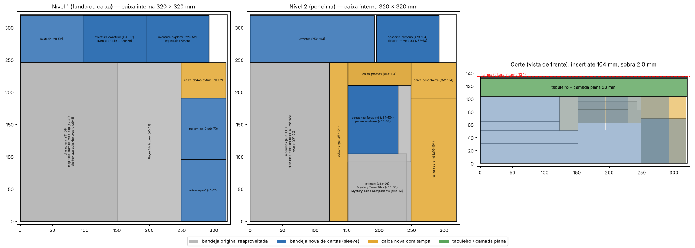

# insertgen: inserts de caixa em STL, com medidas exatas e validação

Gerador paramétrico de organizadores (inserts) para caixas de jogo. Você descreve a caixa, as cartas, os sleeves e
o que vai deitado por cima (tabuleiro, fichas, manual). O `gerar.py` monta as peças e só entrega STL que passou em
todas as checagens:

- **Malha fechada e orientada**: toda aresta tem par, o volume é positivo e não há triângulo degenerado. A checagem é
  feita no sólido e de novo no arquivo gravado, relido do disco.
- **Medida exata**: o tamanho gerado precisa bater com o declarado com tolerância de 0,01 mm. A peça fica apoiada em
  z = 0 e precisa caber na mesa da impressora (256 x 256 mm por padrão).
- **Parede mínima**: a checagem procura, fatia por fatia, qualquer parede mais fina que `parede_min` (1,2 mm). Foi ela
  que pegou o primeiro rebaixo de tampa, que estava com 1,0 mm.
- **Cartas cabem**: cada maço luvado é modelado como um bloco (sleeve x quantidade x espessura). Esse bloco não pode
  tocar o plástico nem passar da borda da bandeja.
- **Montagem**: nenhuma peça pode sair da caixa nem se sobrepor a outra. Peça empilhada precisa de pelo menos 60% da
  base apoiada. O volume do tabuleiro e da camada plana tem que ficar livre até a tampa.

Se qualquer checagem falhar, o comando termina com código 1 e lista o problema.

```
pip install -r tools/inserts/requirements.txt
python3 tools/inserts/gerar.py                    # gera tools/inserts/saida/robinson-crusoe-ce/
python3 -m unittest discover -s tools/inserts/tests -t tools/inserts
python3 -I tools/inserts/analisar_original.py insert.zip   # diagnostica um insert pronto
```

## Robinson Crusoe — Edição de Colecionador, com sleeves Bucaneiros

### O problema no insert original

O zip enviado é o insert **js500** (Printables 953093) mais o remix com Mistérios (Mystery Tales). O `analisar_original.py`
mede os poços de carta direto nos STLs:

| Bandeja original | Poço | Carta grande em Bucaneiros Padrão Euro | Resultado |
|---|---|---|---|
| `obj_5_cards-events-and-wreckage` | 93,0 mm | 95,0 mm (+1 de folga = 96) | **não cabe: faltam 3,0 mm** |
| `obj_6_Mystery Tales Cards` | 94,8 mm | 95,0 mm | **não cabe: faltam 1,2 mm** |
| `obj_8_cards-inventions...` (pequenas) | 74,0 mm | 71,0 mm (Mini Euro) | cabe |
| `obj_9_cards-beasts` (pequenas) | 50,0 mm | 47,5 mm | cabe |

O próprio autor do js500 diz que o projeto é para o **playmat de neoprene** e que o tabuleiro de papelão só cabe se a
tampa ficar levantada. Por isso o original também não tem espaço para o tabuleiro.

### A solução (versão 2, "misto", para o Bucaneiros PADRÃO)

O sleeve escolhido é o **Bucaneiros PADRÃO** (63,5 x 88), com medida externa estimada em **66 x 91 mm**. A carta da
Edição de Colecionador provavelmente mede 57,5 x 89 (ver PESQUISA.md). O sleeve aceita carta até 1,5 mm maior que o
tamanho nominal.

Comparação medida nos STLs dos outros projetos:

| Projeto | Limite medido | PADRÃO 66 x 91 |
|---|---|---|
| js500 | poço deitado de 62 de largura | não cabe |
| Sortirus | poço de 61,6 de largura | não cabe |
| PengLord | carta em pé no poço de 93, bandeja de 73,2 | cabe |

**Como fica o insert misto:**

- **Maços de jogo deitados** (vão para a mesa):
  - Eventos, com compra e descarte na mesma peça;
  - as 3 Aventuras, Mistério e Especiais;
  - 2 descartes vazios (aventura e mistério).

  O poço tem **68,5 x 93,5 mm**, ou seja, sleeve + 1,25 mm por lado. Tem entalhe de dedo nas laterais e furo no fundo.
  As bandejas de meia altura empilham: o fundo de uma é a tampa da outra.
- **Maços dos Mistérios em pé** (guarda), no estilo PengLord:
  - a carta fica apoiada no lado comprido, num poço de 93 mm e numa bandeja de 70 mm de altura;
  - os maços são separados por **divisórias soltas** (imprima 3);
  - há um recorte grande na frente e atrás para puxar as cartas.
- **Cartas pequenas** (Bucaneiros MINI EURO): 2 bandejas de 2 poços (50 x 73,5 mm), empilhadas na coluna das
  miniaturas.
- **Componentes**: as 10 bandejas do original continuam. As caixas novas com tampa embutida completam os vãos.
- **Tabuleiro**: o topo é plano a **104 mm**, e o espaço dali até a tampa fica reservado para o tabuleiro dobrado, as
  fichas e o manual.
- **Ocupação**: o insert ocupa 318,7 x 318,5 mm do fundo. A conferência é feita contra 320 x 320, que ainda é uma
  estimativa.



**Portabilidade:**

- Tirar da caixa: cada bandeja de jogo vai inteira para a mesa, como monte de compra ou de descarte.
- Mistérios e caixas com tampa ficam fechados até a hora de usar.
- Guardar: a planta acima mostra o lugar de cada peça, e o tabuleiro vai deitado por cima.

### Antes de imprimir: meça 5 números

Ninguém publicou estes dados. Os valores em `projetos/robinson-crusoe-ce.json` estão marcados `"status": "estimado"`.

1. **Caixa por dentro**: largura, profundidade e altura útil com a tampa fechada. O padrão é 320 x 320 x 134. Pela
   Portal a caixa tem 33 x 33 x 14 cm por fora, e o insert original ocupa 318,4 mm.
2. **Camada plana**: espessura do tabuleiro dobrado + fichas de cenário + fichas de personagem + manual. O padrão é
   28 mm, e cabem até 30 mm se a altura interna for 134.
3. **Sleeve Bucaneiros**: largura e altura por fora, medidas num sleeve com carta dentro. Preencha `"medido"` em
   `dados/sleeves_bucaneiros.json`, porque a Bucaneiros só informa o tamanho da carta.
4. **Carta**: tamanho e espessura. Meça 10 cartas empilhadas e divida por 10.
5. **Quantidade de cartas** de cada maço, sobretudo as dos Mistérios: as fontes divergem sobre quais são pequenas.

Depois rode `gerar.py` de novo. Se algo deixar de caber, ele diz o que e por quanto.

### O que imprimir

- **Antes de tudo:** imprima as peças de `saida/teste-encaixe/` (`python3 tools/inserts/gerar_teste.py`). São um poço
  deitado, uma bandeja em pé, um poço de carta pequena e uma tampa, com as mesmas folgas do insert. Confira o encaixe
  com o seu sleeve e ajuste `Params` se precisar.
- Os **23 STLs** de `saida/robinson-crusoe-ce/`. A `divisoria-em-pe` sai em **3 cópias**; o resto, 1 de cada (as
  quantidades estão no `relatorio.json`).
- As 10 bandejas originais que continuam valendo: `obj_3`, `obj_11` a `obj_17`, `obj_19` e `obj_20`. Os originais que
  tinham cartas são substituídos.
- PLA ou PETG, camada de 0,2 mm, sem suporte, com a boca para cima. As bandejas em pé têm parede de 1,2 mm: use 3
  perímetros.

## Estrutura

```
insertgen/geom.py      primitivas (caixa arredondada, cavidade em concha, entalhe de dedo)
insertgen/cartas.py    sleeves (catálogo Bucaneiros), carta luvada, altura do maço
insertgen/pecas.py     bandeja de baralhos, bandeja de fichas com tampa, calço
insertgen/validar.py   malha, medidas, parede fina, conteúdo cabe, montagem
insertgen/previa.py    planta, corte e vista 3D (PNG)
insertgen/stl.py       STL binário só com numpy
projetos/              um arquivo .py (layout) + .json (medidas) por jogo
dados/                 catálogo de sleeves
```

Para outro jogo, copie `projetos/robinson_crusoe_ce.py` e o JSON dele, troque as medidas e o layout e aponte o
`gerar.py` para o novo projeto.
